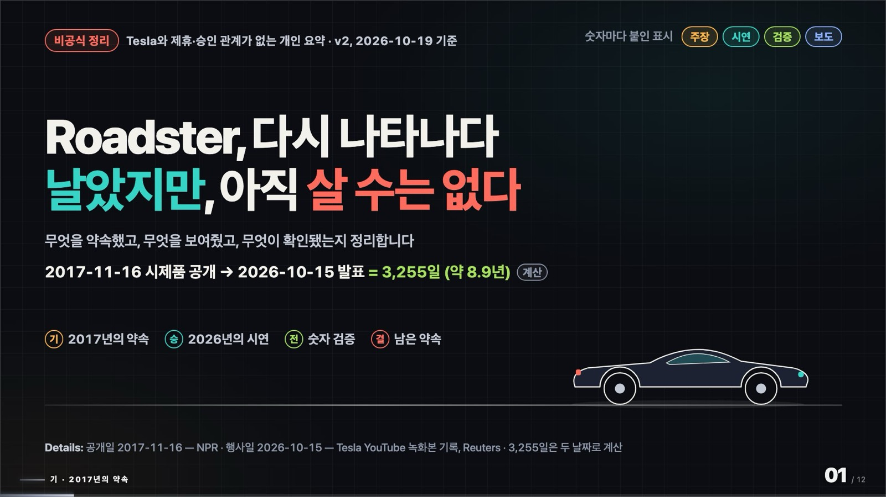
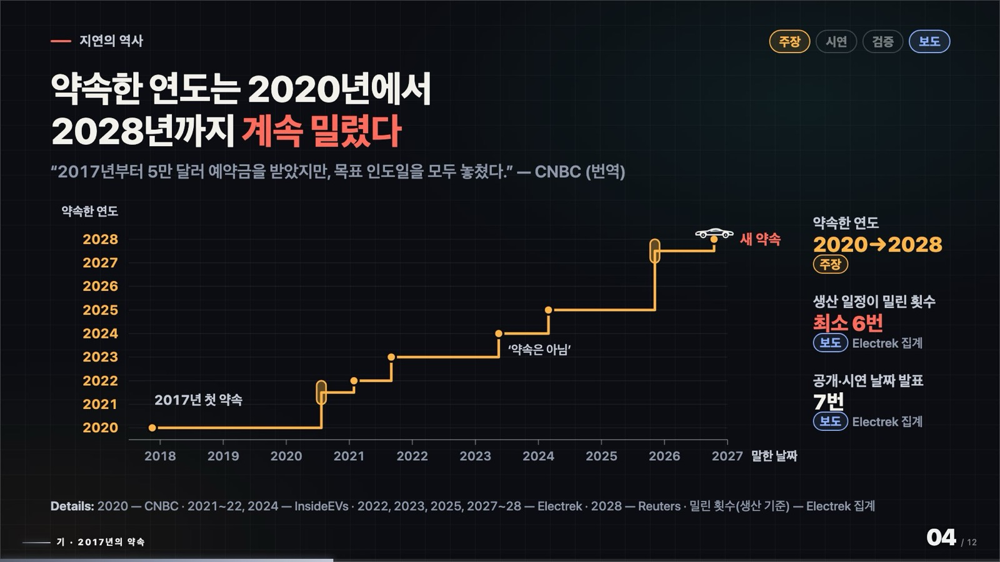
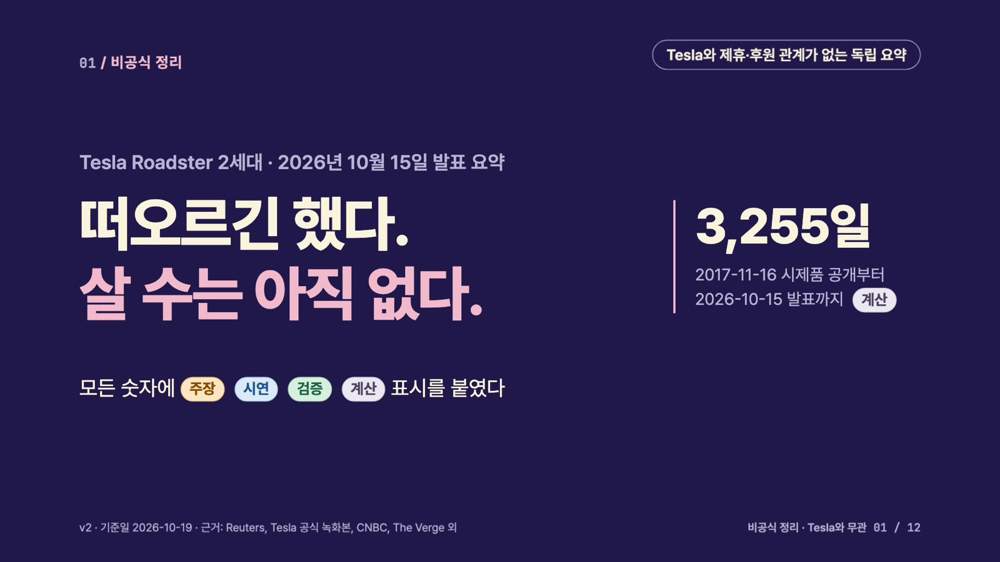
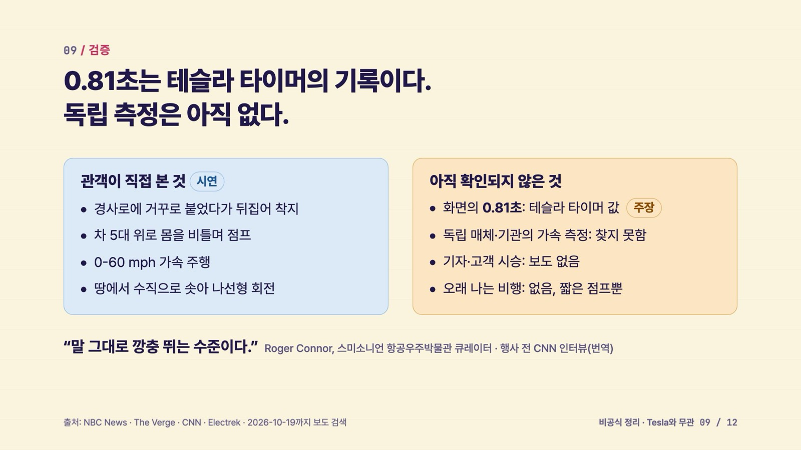
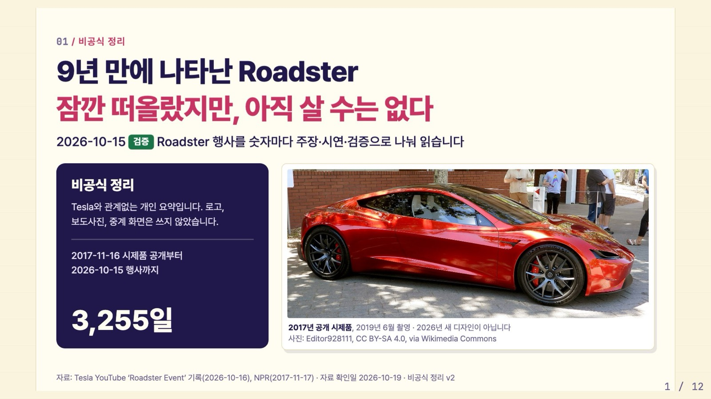
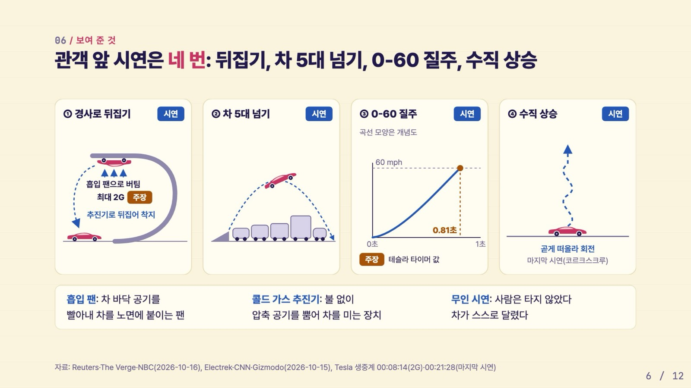
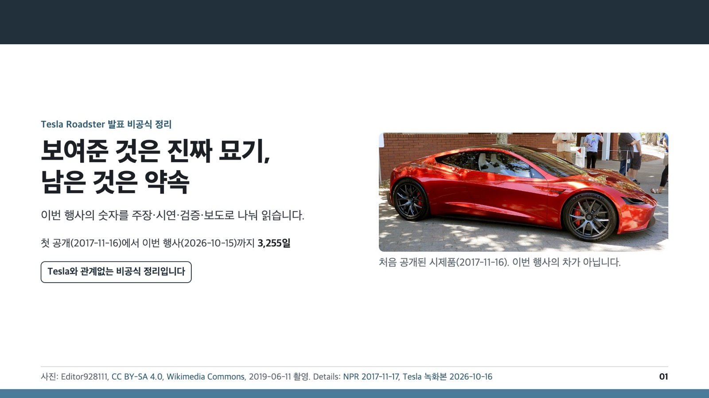
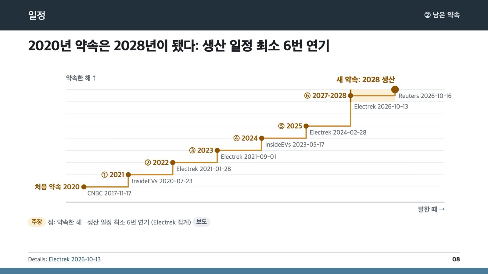

# pt-maker-skill

`pt-maker`는 메모, 문서, URL, 리서치 자료를 받아 발표자료를 기획하고, 만들고, 검사까지 해 주는 agent 스킬(skill, agent가 읽고 따르는 작업 설명서와 스크립트 묶음)입니다. Codex와 Claude Code에서 씁니다. 발표자료를 자주 만들지만 구성·디자인·검수에 매번 시간을 쏟고 싶지 않은 사람, 그리고 공모전·투자 심사·지원사업처럼 숫자 하나와 템플릿 규칙 하나가 점수로 이어지는 자리에 덱을 내야 하는 사람을 위해 만들었습니다. 처음에 포맷을 하나 고르면, 그 포맷에 맞는 HTML과 PDF를 만들고, 실제로 렌더한 화면을 검사한 뒤 후보로 보여 줍니다.

- 포맷은 네 가지입니다: 애니메이션 위주, 줄글 위주, 이미지 위주, 심사·제출용.
- 렌더링·미리보기·스크린샷은 사용자의 Chrome과 분리된 background browser-harness(브라우저를 코드로 조종하는 도구)에서 합니다.
- HTML·미디어·PDF·애니메이션 검사와 사용자 리뷰 단계를 통과해야 완성으로 봅니다.

## 설치

### 필요한 것

- Python 3
- Chrome 또는 Chromium. 기본 위치가 아니면 `PT_MAKER_CHROME_EXECUTABLE`에 실행 파일 경로를 적습니다.
- 애니메이션 위주를 쓸 때만: Node.js(`npx`). 고정된 HyperFrames 0.7.70을 `npx`로 받아 실행합니다.
- 선택 패키지: `pymupdf`와 `pillow`(contact sheet, 화면과 1:1인 Reveal PDF), `segno`(심사용 덱의 QR 코드)

```bash
python3 -m pip install pymupdf pillow segno   # 선택
```

### 어디에 설치하나

| 도구 | 모든 프로젝트에서 쓰기(전역) | 이 프로젝트에서만 쓰기(로컬) |
|---|---|---|
| Codex | `~/.codex/skills/pt-maker` | `<프로젝트>/.codex/skills/pt-maker` |
| Claude Code | `~/.claude/skills/pt-maker` | `<프로젝트>/.claude/skills/pt-maker` |

```bash
git clone https://github.com/csm-kr/pt-maker-skill.git

# Codex, 전역
mkdir -p ~/.codex/skills
cp -R pt-maker-skill/pt-maker ~/.codex/skills/
python3 ~/.codex/skills/pt-maker/scripts/browser_harness_runtime.py --ensure

# Claude Code, 전역
mkdir -p ~/.claude/skills
cp -R pt-maker-skill/pt-maker ~/.claude/skills/
python3 ~/.claude/skills/pt-maker/scripts/browser_harness_runtime.py --ensure

# 프로젝트 로컬은 ~ 대신 프로젝트 폴더를 씁니다. 예: Claude Code
mkdir -p /path/to/project/.claude/skills
cp -R pt-maker-skill/pt-maker /path/to/project/.claude/skills/
python3 /path/to/project/.claude/skills/pt-maker/scripts/browser_harness_runtime.py --ensure
```

`--ensure`는 렌더링에 꼭 필요한 browser-harness를 준비합니다. 없으면 `uv tool install`로 설치하고(`uv`가 없으면 `pt-maker/.runtime/` 안에만 따로 받습니다), Chrome을 찾습니다. `browser-harness background: ready (...)` 한 줄이 나오면 준비가 끝난 것입니다. 설치 없이 상태만 보려면 `--check`를 씁니다.

### 스크립트 경로는 `S`로 줄여 씁니다

이 README의 명령은 스크립트 폴더를 `$S`로 적습니다. 설치한 위치에 맞게 하나만 정해 두세요.

```bash
S=~/.codex/skills/pt-maker/scripts     # Codex 전역
S=.codex/skills/pt-maker/scripts       # Codex 프로젝트 로컬 (프로젝트 폴더에서 실행)
S=~/.claude/skills/pt-maker/scripts    # Claude Code 전역
S=.claude/skills/pt-maker/scripts      # Claude Code 프로젝트 로컬 (프로젝트 폴더에서 실행)
```

스크립트는 자기 위치를 기준으로 템플릿을 찾기 때문에 어디에 설치해도 똑같이 동작합니다. 새 덱은 명령을 실행한 폴더의 `output/` 아래에 생깁니다(`new_deck.py --root`로 바꿀 수 있습니다). `pt-maker/SKILL.md`의 명령 예시는 Codex 프로젝트 로컬 경로(`.codex/skills/pt-maker/scripts/`)로 적혀 있으니, 다른 곳에 설치했다면 위 `S` 값으로 바꿔 읽으면 됩니다.

### Codex와 Claude Code에서 다른 점

| | Codex | Claude Code |
|---|---|---|
| 부르는 법 | `$pt-maker ...` | `/pt-maker ...` 또는 "pt-maker로 ... 만들어줘" |
| 부족한 이미지 채우기 | `$imagegen` 스킬의 built-in `image_gen`으로 생성 | 이미지 생성 도구가 없으므로 웹·공개 자료와 직접 그린 SVG/CSS 일러스트·도식으로 채움 |
| browser-harness 등록 파일 | `~/.codex/skills/browser-harness/SKILL.md`(또는 `$CODEX_HOME` 아래) | `--ensure`가 같은 파일을 `~/.codex` 아래에 만듭니다. Claude Code는 이 파일을 읽지 않지만, pt-maker 스크립트가 `browser-harness` 실행 파일을 직접 부르므로 그대로 동작합니다 |

## 처음 써 보기

Codex에서는 이렇게 부릅니다.

```text
$pt-maker 제품 소개 발표자료를 15장으로 만들어줘.
```

Claude Code에서는 이렇게 부릅니다.

```text
/pt-maker 제품 소개 발표자료를 15장으로 만들어줘.
```

부르면 다른 일보다 먼저 아래 질문 하나만 합니다. 요청문에 포맷을 이미 적었어도 이 질문부터 합니다.

```text
어떤 포맷으로 만들까요?
1. 애니메이션 위주
2. 줄글 위주
3. 이미지 위주
4. 심사·제출용 (지정 템플릿 + 근거 검사)
```

번호로 답하면 됩니다. `그냥 진행`, `알아서`, `넘어가`, `상관없음`처럼 고르지 않고 넘어가면 **3. 이미지 위주**로 진행합니다. 그다음 인테이크(목적, 청중, 한 줄 메시지 등을 묻는 인터뷰)도 한 번에 질문 하나씩 이어집니다.

**1~3번은 예전과 똑같이 동작합니다.** 4번을 골랐을 때만 심사용 질문과 검사가 더해집니다.

## 네 가지 포맷

보통은 agent가 아래 명령을 대신 실행합니다. 직접 돌려 보고 싶을 때 쓰세요. `$S`는 위 설치 단계에서 정한 스크립트 폴더입니다.

`new_deck.py`는 실행할 때마다 `output/` 안에 `<순번>_<slug>_<날짜>` 폴더(예: `output/01_topic-slug_20261019`)를 만들고, 마지막 줄에 그 경로를 출력합니다. 아래 명령의 `output/NN_topic-slug_YYYYMMDD`가 그 경로입니다.

### 1. 애니메이션 위주

- **언제 쓰나:** 화면 앞에서 말로 이끄는 발표에서, 흐름이나 변화를 움직임으로 보여 주고 싶을 때.
- **무엇이 나오나:** HyperFrames(HTML 장면을 시간에 맞춰 재생하는 애니메이션 도구) 프로젝트와, 좌우 키·스페이스·터치로 넘기는 발표용 HTML 하나. 장면에 들어갈 때마다 그 장면의 애니메이션이 처음부터 다시 재생됩니다. MP4·WebM·GIF 영상은 따로 요청할 때만, 미리보기 승인과 영상 검사를 거쳐 만듭니다.
- **시작 명령:**

  ```bash
  python3 $S/new_deck.py "topic-slug" --production-direction animation
  # 장면을 완성한 뒤 발표용 HTML 만들기
  python3 $S/build_animated_presentation.py output/NN_topic-slug_YYYYMMDD/animation \
    -o output/NN_topic-slug_YYYYMMDD/animation/<주제>-발표용-v1.html
  ```

- **예시:** [`examples/tesla-roadster/1-animation/`](examples/tesla-roadster/1-animation/). 종이 질감 스타일은 아래 "paper-motion 스타일"을 보세요.

### 2. 줄글 위주

- **언제 쓰나:** 강의, 보고, 스터디 공유처럼 문장 자체가 핵심일 때. 화면을 같이 보며 읽는 자료.
- **무엇이 나오나:** 1280×720 크기의 Reveal.js(브라우저에서 넘기는 HTML 슬라이드 라이브러리) HTML과 PDF. 제목과 문장이 주인공이고, 큰 한 문장·대비·계단식 문구·숫자 중심 같은 글자 배치를 섞어 글 벽이 되지 않게 합니다. 이미지는 거드는 역할만 합니다.
- **시작 명령:**

  ```bash
  python3 $S/new_deck.py "topic-slug" --production-direction text
  python3 $S/export_pdf.py output/NN_topic-slug_YYYYMMDD/deck.html
  ```

- **예시:** [`examples/tesla-roadster/2-text/`](examples/tesla-roadster/2-text/)

### 3. 이미지 위주 (건너뛰면 이것)

- **언제 쓰나:** 제품, 장소, 사례처럼 눈으로 봐야 믿는 내용일 때.
- **무엇이 나오나:** Reveal.js HTML과 PDF. 주요 문장마다 그 문장을 설명하거나 증명하는 이미지가 한 장 이상 들어갑니다. 사용자 자료와 공식·공개 이미지를 먼저 찾고, 부족하면 Codex에서는 `$imagegen`으로 만들고 Claude Code에서는 SVG/CSS로 직접 그립니다. 생성한 그림은 사실의 증거로 쓰지 않고, 모든 출처는 `assets/CREDITS.txt`에 남깁니다.
- **시작 명령:**

  ```bash
  python3 $S/new_deck.py "topic-slug" --production-direction image
  # 고급: 이미지 위주 덱과 애니메이션 프로젝트를 함께 만들 때
  python3 $S/new_deck.py "topic-slug" --production-direction image --mode both
  ```

- **예시:** [`examples/tesla-roadster/3-image/`](examples/tesla-roadster/3-image/)

### 4. 심사·제출용 (지정 템플릿 + 근거 검사)

- **언제 쓰나:** 공모전, 투자 심사, 지원사업, 입찰처럼 채점 기준표가 있거나 지정 템플릿에 맞춰 PDF를 내야 할 때.
- **무엇이 나오나:** 템플릿 크기(기본 1920×1080)의 고정 HTML 슬라이드와, 화면과 1:1인 제출용 PDF. 스타일은 고정입니다: 실제 제품 화면 캡처, 주장형 문장, 인라인 SVG 도식. 애니메이션은 쓰지 않습니다. 모든 숫자는 근거 장부에서 오고, 숫자가 있는 쪽에는 footer에 출처 줄이 보입니다.
- **시작 명령:**

  ```bash
  python3 $S/new_deck.py "topic-slug" --production-direction judged --template template.pptx
  ```

- **예시:** [`examples/tesla-roadster/4-judged/`](examples/tesla-roadster/4-judged/). 흐름 전체는 바로 아래에서 설명합니다.

## 심사·제출용 자세히 보기

### 왜 따로 있나

심사위원은 짧은 시간에 많은 덱을 넘기며 기준표에 점수를 매깁니다. 이런 자리에서는 예쁜 덱보다 **한 번 읽고 믿을 수 있는 덱**이 이깁니다. 이유는 세 가지입니다.

- 심사위원은 숫자를 확인합니다. 숫자 하나가 틀리면 나머지 숫자도 의심받습니다.
- 템플릿 규칙(쪽수, 파일 크기, 최소 글자 크기, 슬롯 순서)을 어기면 감점되거나 실격될 수 있습니다.
- 출처 없는 숫자는 맞더라도 신뢰를 잃습니다.

그래서 이 모드는 사람 눈에만 맡기지 않고 스크립트가 이 세 가지를 막습니다. 여기서 "막는다"는 문제가 있으면 실패로 끝나고, 어디를 어떻게 고칠지 함께 알려 준다는 뜻입니다.

### 처음에 묻는 네 가지

4번을 고르면 바로 아래 네 가지를 한 번에 하나씩 묻습니다. 답은 덱 폴더의 `judged.json`과 `NOTES.md`에 적힙니다. 모르는 항목은 `unknown`으로 두고 넘어가도 됩니다.

1. **지정 템플릿:** 제출할 때 써야 하는 템플릿 파일(.pptx)이 있는지 묻습니다. Google Slides라면 파일 > 다운로드 > Microsoft PowerPoint(.pptx)로 받으면 됩니다. → `--template`
2. **채점 기준과 가중치:** 기준마다 배점을 묻고, 합이 100이 되게 적습니다. → `judged.json`의 `criteria`
3. **제한:** 쪽수, 파일 크기(MB), 슬라이드당 단어 수, 마감 시각. → 쪽수·MB·단어 수는 `limits`, 마감은 `NOTES.md`
4. **근거 출처:** 숫자를 가져올 문서, 실제로 열어 볼 수 있는 제품 URL, 저장소 주소. → `NOTES.md` (숫자는 이후 `facts.json`으로)

그다음 평소 인터뷰(목적, 청중, 한 줄 메시지 등)로 이어집니다. 이미 받은 근거 출처는 다시 묻지 않고, 스타일이 고정이라 이미지 수준 질문은 건너뜁니다.

### 흐름 한눈에

```text
템플릿 가져오기 → 숫자 장부 → 실제 화면 캡처 → 빌드
  → 레이아웃 검사 → 숫자 검사 → 눈가림 심사 패널 → 제출 검사
```

1. **템플릿 가져오기** (`import_template.py`, `new_deck.py --template`가 함께 실행합니다)
   - 하는 일: .pptx에서 슬라이드 크기, 배경, 로고·띠 같은 템플릿 아트의 자리, 슬롯(템플릿의 각 쪽 자리, 예: "문제", "결론") 제목, 가장 작은 글자 크기, 글꼴을 읽어 `template.json`에 적고, 슬롯마다 한 쪽씩 `deck.src.html`을 채웁니다. 읽지 못한 것(그룹, 표·차트, 회전 등)은 warning으로 알려 줍니다.
   - 왜: 템플릿 규칙을 사람이 기억하는 대신 숫자로 뽑아 두어야 뒤의 검사가 그 규칙으로 막을 수 있습니다.
2. **숫자 장부** (`facts.json`, `{{fact:id}}`)
   - 하는 일: 슬라이드에 들어갈 숫자를 모두 `facts.json`에 값·단위·주장·출처·확인 날짜와 함께 적고, 슬라이드에는 `{{fact:id}}` 자리표시(빌드할 때 실제 값으로 바뀌는 표시)만 씁니다.
   - 왜: 숫자가 한 곳에만 있으면 고칠 때도 한 곳만 고치면 되고, 출처 없는 숫자가 끼어들 틈이 없습니다.
3. **실제 화면 캡처** (`capture_screens.py`)
   - 하는 일: `shots.json`에 적은 URL을 격리된 브라우저로 열어(클릭·입력 단계도 넣을 수 있습니다) `assets/img/<name>.jpg`로 찍고, `assets/CREDITS.txt`에 URL과 찍은 시각을 남깁니다.
   - 왜: "실제로 동작한다"는 증거는 실제 화면이어야 합니다. 생성 이미지는 근거로 쓰지 않습니다.
4. **빌드** (`build_judged_deck.py`)
   - 하는 일: `deck.src.html`을 `deck.html`로 만듭니다. 자리표시를 장부 값으로 바꾸면서 장부에서 왔다는 표시(`data-fact`)를 달고, `{{link:NAME}}` 링크는 같은 이름의 환경 변수로 채우고, 숫자와 단위가 줄바꿈으로 갈라지지 않게 붙입니다.
   - 왜: 손으로 친 숫자와 장부에서 온 숫자를 검사기가 구별할 수 있어야 합니다.
5. **레이아웃 검사** (`qa_layout_gate.py`)
   - 잡는 것: 템플릿 최소보다 작은 글자, 가장자리·가로 넘침, 템플릿 아트와 겹친 내용, footer 줄 수와 겹침, 잘린 글자, 깨진 이미지, 본편 쪽의 단어 수 초과.
   - 함께 만드는 것: 쪽마다의 `slides/NN.png`, 쪽마다 뽑은 글자 `slides/text.txt`, 템플릿 쪽 크기 그대로인 제출용 PDF.
   - 왜: 소스 코드가 아니라 실제로 그려진 화면을 재야 심사위원이 보는 것과 같아집니다.
6. **숫자 검사** (`qa_facts_gate.py`)
   - 잡는 것: 장부 표시 없는 숫자(장부 값과 같은 숫자를 손으로 쳐도 실패), 숫자가 있는데 출처 줄이 없는 쪽, 뒤가 빈 `Details:`, 금지 표현(기본: first, only, any, 100%, 최초, 유일), 정해진 네 값이 아닌 `status`.
   - 왜: 출처 없는 숫자 하나가 덱 전체의 신뢰를 깎습니다.
7. **눈가림 심사 패널** (subagent + `qa_judge_gate.py`)
   - 하는 일: 채점 기준마다 심사 agent 하나, 그리고 사실 확인 agent 하나를 subagent(작업 중에 따로 띄우는 독립된 보조 agent)로 새로 띄웁니다. 심사는 눈가림(blind, 만든 과정은 모른 채 결과물만 보고 채점)입니다. 심사 agent는 심사위원이 보는 것(`slides/NN.png`, `slides/text.txt`, 자기 기준 하나)만 받고 점수, P0(신뢰를 잃게 하거나 규칙을 어기는, 반드시 고칠 문제), 고칠 점 최대 세 가지를 냅니다. 사실 확인 agent는 슬라이드의 숫자를 `facts.json`과 원문 출처에 하나씩 대조합니다.
   - 잡는 것(`qa_judge_gate.py`): 목표(기본 8.0/10)보다 낮은 가중 점수, 남은 P0, 사실 불일치, 한 심사자가 두 기준을 맡은 경우, 눈가림이 아닌 심사, 심사 뒤에 덱이 바뀐 낡은 장부(덱과 덱이 쓰는 CSS·이미지·글꼴의 해시, 즉 파일 내용으로 만든 지문으로 확인).
   - 왜: 만든 사람은 자기 덱의 빈틈을 잘 못 봅니다. 과정을 모르는 눈이 결과물만 보고 채점해야 실제 심사와 비슷해집니다.
8. **제출 검사** (`qa_submission_gate.py`)
   - 잡는 것: 남은 자리표시, PDF 쪽수·크기 초과, 템플릿 슬롯 순서와 제목, 열리지 않는 링크(2xx·3xx 응답만 통과, `--offline`을 주면 링크 확인만 건너뜁니다).
   - 왜: 빈 링크나 용량 초과 같은 마지막 실수는 내용과 상관없이 감점이나 실격으로 이어집니다.

기존 90점 미감 QA(`qa_score_gate.py`)와 HTML·미디어 검사(`qa_html_guard.py`, `qa_media_guard.py`)도 함께 돕니다. 심사용 덱은 움직임이 없으므로 모션·전환·탐색 항목을 빼고 나머지 86점을 100점으로 환산합니다.

### 명령

```bash
S=~/.claude/skills/pt-maker/scripts     # 설치 위치에 맞게
D=output/01_topic-slug_20261019         # new_deck.py가 마지막 줄에 출력한 폴더

# 1. 스캐폴딩 + 템플릿 가져오기
python3 $S/new_deck.py "topic-slug" --production-direction judged --template template.pptx
#    템플릿만 다시 읽을 때 (슬롯별 제목 비교 방식은 유지됩니다)
python3 $S/import_template.py template.pptx $D

# 2. 숫자 장부: $D/facts.json을 채우고, 슬라이드에는 {{fact:id}}

# 3. 실제 화면 → $D/assets/img/
python3 $S/capture_screens.py $D/shots.json

# 4. 빌드 ({{link:GITHUB_URL}} 같은 링크는 환경 변수로 채움)
GITHUB_URL=… VIDEO_URL=… python3 $S/build_judged_deck.py $D/deck.src.html

# 5. 레이아웃 검사 + slides/NN.png + slides/text.txt + 제출용 PDF
python3 $S/qa_layout_gate.py $D/deck.html --pdf $D/topic-v1.pdf

# 6. 숫자 검사
python3 $S/qa_facts_gate.py $D/deck.html

#    함께 도는 기존 검사
python3 $S/qa_html_guard.py $D/deck.html
python3 $S/qa_media_guard.py $D/deck.html
python3 $S/qa_score_gate.py $D/deck.html $D/qa_ledger.json

# 7. 심사 패널: 빈 장부를 만들고, 심사·사실 확인 결과를 적은 뒤 검사
python3 $S/qa_judge_gate.py --print-template $D/judged.json > $D/judge_ledger.json
python3 $S/qa_judge_gate.py $D/judge_ledger.json

# 8. 제출 검사 (링크가 아직 안 열리면 --offline)
python3 $S/qa_submission_gate.py $D/deck.html $D/topic-v1.pdf --config $D/judged.json
```

`qa_layout_gate.py`가 만든 PDF가 제출본입니다. Reveal용 `export_pdf.py`는 심사용 덱에 쓰지 않습니다. QR 자리표시(`{{qr:url}}`)를 쓸 때만 `segno`가 필요하고, 나머지는 Python 표준 라이브러리와 browser-harness만 씁니다.

### 숫자 장부와 꼬리표

```json
{"facts": [
  {"id": "survey-share", "value": "38", "unit": "%",
   "claim": "Respondents who said they would use it weekly",
   "source": "data/survey-results.csv", "checked": "2026-10-12", "status": "verified"}
]}
```

슬라이드에 `{{fact:survey-share}}`라고 쓰면 빌드가 장부의 값과 단위로 바꿉니다. `source`는 심사위원이나 팀원이 직접 열어 볼 수 있는 파일이나 URL이어야 하고, 숫자가 있는 쪽의 footer에는 `Details: <출처>` 줄이 들어갑니다. 화면에서는 빌드가 천 단위 쉼표를 넣습니다(`200000` → `200,000`). 네 자리 숫자 중 1900–2099는 연도로 보고 그대로 둡니다.

그 숫자가 얼마나 확인된 것인지는 `status`에 적고, 슬라이드에서는 숫자 옆 꼬리표로 보여 줍니다.

| `status` | 꼬리표 | 뜻 |
|---|---|---|
| `claimed` | 주장 | 회사나 발표자가 말한 값 |
| `demonstrated` | 시연 | 관객 앞에서 보여 준 것 |
| `verified` | 검증 | 독립적으로 재거나 확인한 값 |
| `reported` | 보도 | 언론이나 집계가 전한 값 |

보도를 검증으로 올리면 사실을 부풀리게 되고, 주장으로 내리면 말하지 않은 사람의 말이 됩니다. 그래서 출처가 말한 그대로 적습니다.

### 심사 패널은 이렇게 돕니다

- 라운드마다 새 agent를 띄웁니다. 이전 점수나 대화를 넘기지 않으니 앞 점수에 끌려가지 않습니다.
- 심사 agent에게는 `deck.src.html`, CSS, `NOTES.md`, `CHANGES.md`, 작업 대화, 다른 기준의 점수를 주지 않습니다. 실제 심사위원도 이것들을 보지 못하기 때문입니다.
- 통과하지 못하면 P0부터 고치고, 다음으로 가중치가 큰 기준의 고칠 점을 적용한 뒤 빌드 → 검사 → 새 라운드로 갑니다.
- 세 라운드가 지나도 목표에 못 미치면 멈추고, 남은 지적과 선택지(내용 줄이기, 기준 해석 바꾸기, 목표 낮추기)를 사용자에게 묻습니다. 점수를 맞추려고 근거 없는 주장을 더하지 않습니다.

지시문 템플릿과 장부 형식은 [`pt-maker/reference/judge-panel.md`](pt-maker/reference/judge-panel.md), 전체 절차는 [`pt-maker/reference/judged-deck.md`](pt-maker/reference/judged-deck.md)에 있습니다.

### 예시로 따라가기: Tesla Roadster 심사용 덱

2026-10-15 Tesla Roadster 발표를 정리한 비공식 샘플입니다. 실제 대회 템플릿 대신 직접 만든 중립 템플릿("샘플 심사 템플릿", 11슬롯)을 썼습니다.

- 모의 채점 기준: 사실 정확성 40, 메시지 명확성 25, 근거 투명성 25, 디자인 10. 목표 가중 점수 8.0.
- 제한: 15쪽 이하, PDF 5 MB 이하, 쪽당 80단어 이하.
- 결과: 본편 12쪽 + 부록 1쪽 = 13쪽, PDF 1.5 MB.
- 근거 화면: 영어 Wikipedia 문서의 한 문장을 `capture_screens.py`로 찍었습니다. 사진은 Wikimedia Commons의 2017년 시제품 사진 한 장입니다.

라운드별 결과입니다.

- **라운드 1 (v1): 가중 7.0/10.** 네 기준 모두 7점. 사실 확인에서 P0 2건(시연 개수, 일정 차트).
- **라운드 2 (v2): 가중 7.4/10.** 사실 정확성 8, 나머지 7. 네 심사 agent 모두 1순위로 "6번 연기"가 무엇을 센 것인지 물었습니다.
- **라운드 3 (v3): 가중 7.75/10, 목표 미달.** 사실 정확성 8, 메시지 명확성 7, 근거 투명성 8, 디자인 8. P0 2건이 남았습니다. 6쪽 제목이 같은 쪽 차트와 어긋나고, 부록의 출력 환산(1 MW를 1,500마력으로 적음)이 틀렸습니다. 세 라운드가 끝나 사용자에게 물었고, 이 상태 그대로 공개하기로 했습니다. 그래서 이 샘플의 `qa_judge_gate.py judge_ledger.json`은 실패로 남습니다. 점수가 모자라면 관문이 실제로 막는다는 것을 보여 주는 예시이기도 합니다.

사실 확인이 실제로 잡은 것들입니다. 심사 패널이 왜 있는지 잘 보여 줍니다.

- v1은 "관객 앞 시연은 세 가지"라고 했습니다. 사실 확인 agent가 생중계를 다시 열어 보니 네 번째 시연(제자리 수직 이륙 뒤 회전하고 착지, 생중계 21:28–22:12)이 있었습니다. v2는 제목을 "관객 앞에서 4가지를 보여줬다"로 고치고 장부에 `demo-count-live`를 더했습니다.
- 0-60 mph 0.81초에는 "시연" 꼬리표가 붙어 있었습니다. 주행은 관객 앞에서 했지만 숫자는 테슬라 자체 타이머 값이었습니다. 숫자는 "주장", 주행만 "시연"으로 나눴습니다.
- 일정 차트에 2025년 11월 발언(생산 2027년 또는 2028년)이 빠져 있었습니다.
- 라운드 2에서는 "6번 연기"가 생산 일정이 아니라 "발표 날짜 7개"에서 계산한 값이었다는 점이 드러났습니다. v3는 Electrek의 "생산 일정 최소 6번 연기" 집계를 출처로 삼고, 차트의 계단 여섯 개에 번호와 출처를 하나씩 달았습니다.
- 사실 확인도 틀릴 수 있습니다. 라운드 2는 라운드 1의 정정 하나를 다시 뒤집었습니다(Rimac 1.74초는 제조사 주장이 아니라 독립 계측 기록). 라운드마다 새 agent가 원문을 다시 여는 이유입니다.

이 오류들은 네 샘플이 함께 쓰는 리서치에 있었기 때문에 1~3번 샘플도 같은 수정을 반영했습니다. 패스마다 무엇을 왜 고쳤는지는 [`CHANGES.md`](examples/tesla-roadster/4-judged/CHANGES.md)에 쌓여 있습니다.

## 예시 모음

같은 주제(2026-10-15 Tesla Roadster 발표)를 네 포맷으로 하나씩 만든 샘플입니다. 네 덱 모두 같은 리서치 장부의 숫자만 쓰고, 같은 이야기를 합니다. **"보여준 것은 진짜였지만, 가격·출시일·성능은 아직 약속이다."** 달라지는 것은 그 이야기를 전하는 방식입니다. 기본 경로는 [`examples/tesla-roadster/`](examples/tesla-roadster/)입니다.

| 포맷 | 컨셉 | 이런 자리에 | 품질 점수 |
|---|---|---|---|
| 1. 애니메이션 위주 | 차가 직접 이야기를 끌고 가는 발표 무대 | 화면을 넘기며 말로 하는 발표 | 90/100 |
| 2. 줄글 위주 | 제목만 읽어도 이야기가 끝나는 잡지 기사 | 논리를 전하는 발표, 읽히는 자료 | 92/100 |
| 3. 이미지 위주 | 모든 문장에 증거 그림이 붙는 시각 해설서 | 처음 보는 사람에게 한눈에 설명 | 91/100 |
| 4. 심사·제출용 | 심사위원이 사실을 확인해도 버티는 보고서 | 대회·투자·지원사업처럼 채점받는 자리 | 심사 7.75/10 |

1~3번 점수는 독립 리뷰 agent의 100점 품질 채점이고, 4번은 눈가림 심사 패널의 가중 점수(목표 8.0)입니다.

### 1. 애니메이션 위주: 차가 직접 이야기를 끌고 가는 발표 무대

<p>


</p>

- **제목:** "Roadster, 다시 나타나다: 날았지만, 아직 살 수는 없다"
- **보이는 모습:** 검은 무대에 은은한 격자가 깔리고, 직접 그린 SVG 차 한 대가 12장면 내내 등장합니다. 지연 그래프의 선을 따라 달리고(오른쪽 장면), 막대 위를 타고, 마지막에는 "아직 생산 전"이라는 점선 윤곽으로 바뀝니다. 장면에 들어올 때마다 그 장면의 빌드가 처음부터 재생됩니다.
- **이런 자리에:** 화면을 넘기며 말로 하는 발표. 움직임이 장면마다 시선을 붙잡습니다.
- **파일:** 발표용 HTML [`tesla-roadster-발표용-v2.html`](examples/tesla-roadster/1-animation/animation/tesla-roadster-발표용-v2.html), HyperFrames 프로젝트 [`animation/`](examples/tesla-roadster/1-animation/animation/), 전체 장면 [contact sheet](examples/tesla-roadster/1-animation/qa/contact-sheet.png), [작업 노트](examples/tesla-roadster/1-animation/build-notes.md)

### 2. 줄글 위주: 제목만 읽어도 이야기가 끝나는 잡지 기사

<p>


</p>

- **제목:** "떠오르긴 했다. 살 수는 아직 없다."
- **보이는 모습:** 크림색 종이 위에서 글자가 주인공입니다. 큰 한 문장, 좌우 대비(오른쪽 슬라이드), 계단식 문구, 큰 숫자, 잡지식 글 격자 같은 글자 배치 다섯 가지를 번갈아 써서 글 벽이 되지 않게 했습니다. 사진은 한 장뿐입니다.
- **이런 자리에:** 생각과 논리를 전하는 발표, 또는 회의 전에 미리 읽히는 자료.
- **파일:** [PDF](examples/tesla-roadster/2-text/TeslaRoadster2026v2.pdf), [HTML](examples/tesla-roadster/2-text/TeslaRoadster2026v2.html), 전체 쪽 [contact sheet](examples/tesla-roadster/2-text/TeslaRoadster2026v2_contact.png), [작업 노트](examples/tesla-roadster/2-text/build-notes.md)

### 3. 이미지 위주: 모든 문장에 증거 그림이 붙는 시각 해설서

<p>


</p>

- **제목:** "9년 만에 나타난 Roadster / 잠깐 떠올랐지만, 아직 살 수는 없다"
- **보이는 모습:** 슬라이드마다 그 문장을 증명하는 그림이 붙습니다. 2017년 시제품 실물 사진(공개 라이선스), 시연 네 장면 그림(오른쪽), 세 등급 비교, 0-60 막대 차트, "아직 비어 있다"는 빈 체크박스 세 개가 그 예입니다. Claude Code에서 만들어 생성 이미지는 없고, 사진 외의 그림은 모두 직접 그린 SVG/CSS입니다.
- **이런 자리에:** 처음 보는 사람에게 한눈에 이해시켜야 하는 자리.
- **파일:** [PDF](examples/tesla-roadster/3-image/테슬라로드스터발표v2.pdf), [HTML](examples/tesla-roadster/3-image/테슬라로드스터발표v2.html), 전체 쪽 [contact sheet](examples/tesla-roadster/3-image/테슬라로드스터발표v2_contact.png)

### 4. 심사·제출용: 심사위원이 사실을 확인해도 버티는 보고서

<p>


</p>

- **제목:** "보여준 것은 진짜 묘기, 남은 것은 약속"
- **보이는 모습:** 정해진 템플릿(여기서는 직접 만든 "샘플 심사 템플릿")을 그대로 따릅니다. 위쪽 띠에 "① 보여준 것 / ② 남은 약속" 구간 표시가 있고, 숫자마다 주장(주황)·시연(파랑)·검증(초록)·보도(회색) 꼬리표가 붙으며, 모든 쪽 아래에 날짜가 붙은 출처가 있습니다. 오른쪽 일정 차트는 계단 ①~⑥마다 출처를 따로 답니다. 마무리 질문은 "숫자를 들으면 물어보세요: 누가 말했고, 무엇으로 확인했나?"입니다.
- **이런 자리에:** 대회, 투자 심사, 지원사업처럼 채점받는 자리. 눈가림 심사 세 라운드(7.0 → 7.4 → 7.75)를 거쳤고, 목표 8.0에 못 미친 채로 그대로 공개했습니다(위 "예시로 따라가기" 참고).
- **파일:** 제출용 [PDF](examples/tesla-roadster/4-judged/TeslaRoadsterJudgedv3.pdf), 근거 장부 [`facts.json`](examples/tesla-roadster/4-judged/facts.json), 심사 패널 장부 [`judge_ledger.json`](examples/tesla-roadster/4-judged/judge_ledger.json), 샘플 템플릿 [`sample-judged-template.pptx`](examples/tesla-roadster/4-judged/template/sample-judged-template.pptx), 전체 쪽 [contact sheet](examples/tesla-roadster/4-judged/TeslaRoadsterJudgedv3_contact.png), 라운드별 [`CHANGES.md`](examples/tesla-roadster/4-judged/CHANGES.md)

> **샘플에 대해**
> - 비공식 요약이며 Tesla와 제휴·후원 관계가 없습니다.
> - 사진과 화면 캡처는 공개 라이선스(CC BY-SA 4.0, CC BY 2.0) 자료만 썼고, 출처는 각 예시 폴더의 `CREDITS.txt`에 있습니다. 나머지 그림은 직접 그린 SVG/CSS입니다. 로고, 보도 사진, 생중계 화면은 쓰지 않았습니다.
> - HTML 덱은 글꼴과 라이브러리(Reveal.js, GSAP)를 CDN에서 불러오므로 인터넷에 연결돼 있어야 제대로 보입니다. PDF는 오프라인에서도 열립니다.
> - GitHub에서 `.html`을 누르면 코드가 보입니다. 저장소를 내려받아 브라우저로 여세요.

## paper-motion 스타일

종이 질감 모션그래픽과 화자 캐릭터가 나오는 애니메이션 덱입니다.
[motion-demo-video](https://github.com/csm-kr/motion-demo-video)의 모션그래픽
원칙과 레퍼런스 영상 분석을 바탕으로 만들었습니다.

- 고르는 법: 첫 포맷 질문에서 `1. 애니메이션 위주`를 고른 뒤, 분위기를 묻는 질문에서 "종이 모션그래픽"이나 "화자 캐릭터"라고 말합니다.
- 빌드 전에 읽는 파일
  - `pt-maker/paper-motion-taste-profile.md`: 이 스타일의 취향 프로필
  - `pt-maker/reference/motion-graphics-grammar.md`: 모션 원칙
  - `pt-maker/assets/speaker-character/README.md`: 부엉이 캐릭터 사용법
- 화자 캐릭터는 코드로 그린 부엉이 SVG입니다. 이미지 생성이 아니라서 Claude Code에서도 그대로 쓰고, 같은 시각에는 언제나 같은 포즈가 나옵니다.
- 발표용 HTML은 종이 테마로 만듭니다.

```bash
python3 $S/build_animated_presentation.py \
  output/NN_topic_date/animation --theme paper \
  -o output/NN_topic_date/animation/<주제>-발표용-vN.html
```

- 장면 사이 전환은 기본이 하드컷(효과 없이 바로 바뀌는 전환)입니다. 짧은 종이 밀기 전환이 필요한 장면에만 clip host(장면 하나를 감싸는 요소)에 `data-transition="paper"`를 붙입니다.
- 화면 하단의 장 이름은 clip host의 `data-chapter` 값을 씁니다. 값이 없으면 그 장면의 첫 제목(h1~h3)을 쓰고, 제목도 없으면 숨깁니다.

## Background 실행

`pt-maker`는 사용자가 보고 있는 Chrome에 붙지 않습니다. 렌더링, 미리보기, 스크린샷, PDF 출력은 임시 프로필과 별도 CDP 포트(CDP: 코드로 Chrome을 조종하는 통로)를 쓰는 headless Chrome(화면 없이 뒤에서 도는 Chrome)에서 하고, 끝나면 browser-harness daemon, 브라우저 프로세스, 임시 프로필을 정리합니다. 그래서 작업하는 동안에도 평소 브라우저를 그대로 쓸 수 있습니다.

HyperFrames의 `check`, `preview`, 그리고 영상을 요청했을 때의 `render`는 `--background`로만 실행됩니다. 빠뜨리면 wrapper가 Codex든 Claude Code든 막습니다. 최종 검수 뒤에는 `stop --target all`로 미리보기 서버까지 모두 끕니다.

```bash
python3 $S/hyperframes_mode.py preview output/NN_topic_date --background
python3 $S/hyperframes_mode.py status output/NN_topic_date
python3 $S/hyperframes_mode.py stop output/NN_topic_date --target all
```

## 이전 방식과 달라진 점

### 4번 심사·제출용 포맷 추가

1~3번 포맷의 동작은 그대로입니다.

| 항목 | 이전 | 지금 |
|---|---|---|
| 첫 포맷 질문 | 3지선다(애니메이션 / 줄글 / 이미지) | 4지선다. `4. 심사·제출용 (지정 템플릿 + 근거 검사)` 추가. 건너뛰면 여전히 이미지 위주 |
| 심사용 인테이크 | 없음 | 4번을 고르면 템플릿 → 채점 기준·가중치 → 제한 → 근거 출처를 하나씩 질문. 1~3번에는 새 질문 없음 |
| `new_deck.py` | `--production-direction animation\|text\|image` | `judged` 추가. `--template template.pptx`로 템플릿을 읽어 요약과 warning을 출력하고 슬롯마다 한 쪽씩 스캐폴딩 |
| 지정 템플릿 | 참고자료로만 흡수 | `import_template.py`: 슬라이드 크기(px, 인치), 배경, 템플릿 아트 영역, 슬롯 제목과 제목 상자, 최소 글자 크기, 글꼴, 건너뛴 것 warning → `template.json` + 템플릿 layer |
| 덱 형식 | Reveal 1280×720 | 심사용은 템플릿 크기 고정 HTML 슬라이드, 템플릿 실제 쪽 크기로 인쇄한 1:1 PDF |
| 숫자와 출처 | 출처는 작업 노트·CREDITS에, 슬라이드에는 최소한 | 심사용은 `facts.json` 장부 + `{{fact:id}}`(빌드가 `data-fact`로 표시) + footer 출처 줄 |
| 숫자 꼬리표 | 없음 | `facts.json`의 `status` → 주장·시연·검증·보도 |
| 근거 이미지 | 웹 이미지 또는 생성 일러스트 | 심사용 근거는 실제 캡처(`capture_screens.py`)나 공개 자료만. 생성 이미지는 근거 금지 |
| 레이아웃 검사 | 렌더 후 사람·agent 검수 | `qa_layout_gate.py`: 실제 글줄 기준 최소 글자(transform 배율 반영), 가장자리·가로 넘침, 템플릿 아트 겹침, footer 줄 수·겹침, 잘림, 깨진 이미지, 본편 단어 수 + 쪽별 PNG·글자 + 1:1 PDF |
| 숫자 검사 | 없음 | `qa_facts_gate.py`: 표시 없는 숫자, 출처 없는 쪽, 빈 `Details:`, 금지 표현, 잘못된 `status` |
| 심사 패널 | 미감 QA agent 1개(90점) | 미감 QA는 그대로 + 채점 기준별 눈가림 심사 agent와 사실 확인 agent. `qa_judge_gate.py`가 가중 점수·P0·사실 불일치와, 심사한 덱과 그 덱이 쓰는 CSS·이미지·글꼴의 해시로 낡은 장부를 막음 |
| 제출 직전 | 없음 | `qa_submission_gate.py`: 자리표시 잔여, PDF 크기·쪽수, 슬롯 순서·제목, 링크 열림(2xx·3xx) |
| HTML guard | Reveal 설정 필수 | `data-deck="judged"` 덱은 Reveal 설정 대신 `@page` 크기 검사 |
| 미감 QA 점수(정적 덱) | 모션·전환·탐색 항목 필수 | 심사용 덱은 그 항목을 빼고 86점을 100점으로 환산 |
| 테스트 | 50개 | 145개 |

### `paper-motion-taste` 브랜치

기본 테마 덱의 동작은 그대로입니다.

| 항목 | 이전 | 지금 |
|---|---|---|
| 애니메이션 스타일 | 네온 계열 전환(prism · curtain · aperture) 한 가지 | `paper-motion` 스타일 추가 |
| 취향 프로필 | `taste-profile.md`, `dark-taste-profile.md` | `paper-motion-taste-profile.md` 추가. 부딪히는 부분은 paper-motion 덱 안에서 이 파일이 우선 |
| 모션 원칙 | `hyperframes-animation-mode.md` | `motion-graphics-grammar.md` 추가: 덱 전체를 관통하는 사물 하나, 같은 사물을 같은 자리에 두고 넘기는 컷, 강조색을 아껴 두었다 한 번 쓰기 등 |
| 화자 캐릭터 | 없음 | 코드로 그린 부엉이 SVG(포즈 5개)와 GSAP 헬퍼 `PtSpeaker` |
| 발표용 HTML 테마 | 네온 테마 하나 | `--theme paper` 추가(네온·플래시 없음, 하드컷 기본) |
| 하단 장 이름 | 다른 덱의 문구(`OPEN THE SCENT`, `MEMBER SIGNAL`)가 모든 덱에 고정으로 나오던 버그 | 장면의 `data-chapter`에서 읽고, 없으면 장면 제목(h1~h3), 둘 다 없으면 숨김. 그래서 예전 덱도 장 이름이 비지 않음 |
| 발표 HTML QA | 전환 종류를 코드에 고정, 로드 직후 첫 전환에서 가끔 실패 | 페이지가 알려 주는 전환 종류를 읽음, 측정 전에 전환을 한 번 미리 실행(warm-up) |
| 이미지 생성 도구가 없는 환경(Claude Code 등) | Codex `$imagegen` 전제 | 캐릭터·일러스트·도식을 SVG/CSS로 만든다는 규칙 추가 |
| 테스트 | 37개 | 50개 |

## 테스트

```bash
cd pt-maker/scripts && python3 -m unittest discover -p 'test_*.py'
```

이 브랜치에서는 145개 테스트가 모두 통과합니다.

## 자주 묻는 질문

**4번을 고르면 1~3번 포맷은 못 쓰나요?**

덱 하나에 포맷 하나입니다. 4번은 그 덱에만 적용되고, 1~3번에는 심사용 질문이나 검사가 붙지 않습니다. 같은 자료로 다른 포맷이 필요하면 `pt-maker`를 다시 불러 새 덱을 만들면 됩니다. 위 Tesla 예시도 같은 리서치로 네 덱을 따로 만든 것입니다.

**실제 대회 템플릿이 PDF뿐이면요?**

`import_template.py`는 .pptx만 읽습니다. Google Slides라면 .pptx로 내려받고, 주최 측에 .pptx 파일이 있는지 먼저 물어보세요. 정말 PDF뿐이라면 `--template` 없이 시작합니다. 그러면 기본 1920×1080 고정 슬라이드로 만들어지고, 템플릿 아트 겹침과 슬롯 순서·제목 검사는 빠집니다. 최소 글자 크기는 `judged.json`의 `layout.min_font_px`에 직접 적고, 렌더된 `slides/NN.png`를 템플릿 PDF와 나란히 놓고 비교하세요.

**심사 agent를 띄울 수 없는 환경이면요?**

`qa_judge_gate.py`는 기준마다 서로 다른 눈가림 심사자를 요구하므로 혼자서는 통과시킬 수 없습니다. 이때는 build-notes에 `judge-panel: unavailable`을 남기고 사용자에게 알립니다. 팀원이나 사용자가 심사자를 맡아도 됩니다. 심사 agent와 같은 입력(쪽별 PNG, `slides/text.txt`, 자기 기준 하나)만 보고 결과를 `judge_ledger.json`에 적으면 됩니다.

**샘플의 숫자는 어디서 왔나요?**

[`examples/tesla-roadster/4-judged/facts.json`](examples/tesla-roadster/4-judged/facts.json)에 있습니다. 항목마다 `claim`(무엇을 말하는 숫자인지), `source`(열어 볼 수 있는 URL), `checked`(확인한 날), `status`(꼬리표)가 적혀 있습니다. 심사용 덱의 출처 페이지(11쪽)는 슬라이드가 쓰는 출처를 모두 링크로 보여 줍니다. 1~3번 샘플도 같은 리서치 장부의 숫자만 썼습니다.

**Claude Code에서 이미지 위주를 고르면 이미지는 어떻게 채우나요?**

Claude Code에는 이미지 생성 도구가 없습니다. 사용자 자료와 공식·공개 이미지를 먼저 쓰고(출처는 `assets/CREDITS.txt`), 나머지 일러스트와 도식은 SVG/CSS로 직접 그립니다. 3번 Tesla 샘플이 이렇게 만들어졌습니다.

**HTML 파일을 열었더니 글꼴이 깨지거나 아무것도 안 움직여요.**

1~3번 HTML은 글꼴과 Reveal.js·GSAP를 CDN에서 불러옵니다. 인터넷에 연결된 상태에서 브라우저로 직접 여세요. GitHub 웹 화면에서는 HTML이 코드로만 보입니다.

스킬의 전체 동작 계약과 QA 기준은 [`pt-maker/SKILL.md`](pt-maker/SKILL.md)를 참고하세요.
